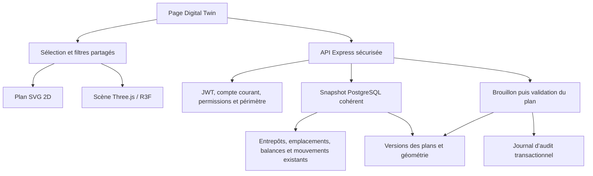

# Triangle Digital Twin — dossier de conception et version candidate

Date : 15 novembre 2026. **Candidate de développement, non déployée, non réceptionnée sur le VPS.**

## 1. Audit réellement effectué

Sources récupérées dans les dépôts `Souldjaboy/triangle-wms-backend` (base `69ebb0179f28127fffd2617f0f444f75b69ebc86`) et `Souldjaboy/triangle-wms-frontend` (base `7d8b1fc65425f01e5e69053ab2bb2b63b23dc6b0`). Les commits de base portent respectivement les dates du 22 et du 18 août 2026. Leur correspondance avec la production de novembre n'est pas établie. Aucun accès à la base réelle, aucune migration, aucune sauvegarde VPS ni aucun déploiement n'a été réalisé.

| Élément      | Constat dans les sources                                                                              | Conséquence                                                                              |
| ------------ | ----------------------------------------------------------------------------------------------------- | ---------------------------------------------------------------------------------------- |
| Backend      | CommonJS, Express 5.2.1, `pg`, monolithe `server.js` et routeurs injectés                             | Nouveau routeur Express ; aucun NestJS ajouté                                            |
| Frontend     | Next.js 16.2.6, React 19.2.4, TypeScript, App Router                                                  | Page `/stocks/digital-twin`, composants isolés et chargement différé de la 3D            |
| Entrepôts    | `warehouses(id, company_id, code, name, location, ...)`                                               | Les entrepôts ne sont pas recréés                                                        |
| Emplacements | `locations` avec anciens champs `zone/rayon/etagere` et `rayon_code/case_code/level_code/bin_code`    | Aucun renommage automatique « ROW = zone » ou « LOCATION = rack »                        |
| Quantités    | `products.stock` global ; `stock_location_balances` répartit par produit et emplacement               | Lecture des balances ; aucune copie des quantités dans les tables 3D                     |
| Réservations | `reserved_quantity` et services existants de réservation                                              | Disponible = quantité − réservé ; réservé n'est pas espace physiquement libéré           |
| Mouvements   | `stock_movements`, source/destination et quantités avant/après                                        | Historique paginé par bin, sans exposer une contrepartie hors périmètre                  |
| Métier       | `services/stock-locations.js`, `stock-operations.js`, `location-rules.js`                             | Aucun moteur de stock remplacé ; réutilisation des règles de bin physique                |
| Droits       | `rbac-triangle.js` historique, `services/permissions.js` avancé                                       | Nouveau module utilise le contexte avancé, avec refus si chargement indisponible         |
| Périmètre    | `users.warehouse_id` apparaît dans les usages ; pas de service unique de périmètre entrepôt identifié | Relecture du compte en base ; affectation existante + habilitations explicites du module |
| Géométrie    | Aucun référentiel complet bâtiment → zone → allée → rack → niveau → bin identifié                     | Configuration manuelle vérifiée, en mètres, reliée aux IDs officiels                     |
| Capacité     | Aucune unité de capacité physique fiable confirmée                                                    | « Non renseignée » ; aucun ratio articles / nombre d'emplacements                        |
| Traçabilité  | Lots présents dans certaines routes, liaison exacte lot/quantité/bin non établie                      | Pas d'affectation artificielle de lots ou de séries                                      |
| Production   | Non inspectée                                                                                         | Audit complémentaire obligatoire avant intégration finale                                |

Points existants à examiner séparément : l'ancien garde RBAC peut continuer après une erreur ; certaines routes historiques `/warehouses` ont des portées plus larges pour les super administrateurs ; `applyToBalance` met à jour le statut du lieu depuis la balance d'un seul produit. Le module calcule ses indicateurs depuis toutes les balances et ne modifie pas ces comportements existants. Les anomalies ne sont pas déclarées corrigées dans le reste du WMS.

## 2. Architecture cible et implémentation

- Une requête de lecture utilise `REPEATABLE READ READ ONLY`. Les transactions de stock non validées ne deviennent pas des quantités visibles.
- Actualisation toutes les 15 secondes quand la page est visible, au retour de focus et après l'événement frontend `triangle:stock-committed` si un écran métier l'émet. Les écrans existants n'émettent pas encore cet événement : le polling reste la garantie implémentée. Ce n'est pas du WebSocket temps réel.
- Aucun endpoint de mutation de stock. Les liens Réceptions, Stocks et Inventaires ouvrent les écrans existants.
- Mise en production désactivée par défaut : `DIGITAL_TWIN_ENABLED=true` nécessaire côté backend ; `NEXT_PUBLIC_DIGITAL_TWIN_ENABLED=true` nécessaire pour le lien du menu Stocks au build frontend.
- Périmètre pilote : au maximum 2 000 objets par plan ; 80 étiquettes simultanées en 3D. La géométrie est rendue par instanciation et à la demande. Aucun benchmark matériel réel n'a encore été réalisé.

## 3. Modèle de données additif

Migration candidate `sql/064_digital_twin.sql` : trois tables seulement ; aucune modification des tables de quantité.

| Table                 | Rôle                                                                   | Contraintes principales                                                                                                        |
| --------------------- | ---------------------------------------------------------------------- | ------------------------------------------------------------------------------------------------------------------------------ |
| `dt_layouts`          | Version de configuration, entreprise, entrepôt, version parente, seuil | Une version publiée par entrepôt/entreprise ; FK RESTRICT ; brouillon/publié/archivé                                           |
| `dt_nodes`            | Hiérarchie et géométrie d'une version                                  | UUID stable ; parent dans la même version ; code unique sous son parent ; un seul lien par emplacement officiel et par version |
| `dt_warehouse_access` | Habilitations additionnelles de consultation par entrepôt              | Aucun droit créé par défaut ; clé entreprise/utilisateur/entrepôt                                                              |

Chaque bin référence `locations.id` ; un rack déplacé garde ses IDs et ses liens. Les éléments publiés ne peuvent pas être supprimés ni changer de nature ou d'emplacement métier : les désactiver conserve leur historique. Les anciennes versions restent archivées. Les brouillons sont des versions immuables ; une nouvelle sauvegarde crée une version.

Géométrie : `x/y/z/width/height/depth/yaw`, coordonnées absolues en mètres ; Y = hauteur. X/Z désignent le coin minimal de l'emprise orientée ; rotations autorisées 0, 90, 180 ou 270°. Les dimensions locales ne sont pas générées. Vérification de l'inclusion dans le parent et du chevauchement des racks/bins frères actifs. Cela ne constitue pas une validation structurelle des rayonnages, des charges ou des voies de circulation.

Capacité : valeur positive et unité métier explicite au bin. Une quantité n'est additionnée que si son unité correspond exactement après normalisation simple (minuscules/espaces). Aucun dictionnaire de conversion pièce/carton/palette, ni interprétation implicite du poids produit. Pour plusieurs références présentes dans le même bin, le taux reste inconnu : des cartons de produits distincts peuvent avoir des dimensions différentes. Des capacités kg/m³ ne sont calculables que si les balances utilisent réellement ces unités ; sinon le taux reste inconnu. Des métriques dédiées de poids/volume par unité de stock restent à développer.

Les agrégats sont séparés par unité ; le ratio d'ensemble n'est fourni que si toutes les capacités du périmètre sont connues et comparables. Les stocks historiques non répartis rattachés à un lieu rendent son état de vide non vérifié. Les produits sans aucun `location_id` ne peuvent pas être attribués à un entrepôt : leur couverture doit être auditée dans le WMS.

## 4. API livrées

Préfixe `/digital-twin` ; JWT existant, compte actif rechargé en base, permissions `stock.view` et contrôle entreprise/tenant sur chaque requête. Les administrateurs/direction reconnus par le service de droits ont le périmètre entreprise ; les autres utilisateurs ne voient que leur affectation existante ou les habilitations explicites. Toute configuration exige un administrateur et `stock.emplacement.update` ; publication exige aussi `stock.emplacement.validate`.

| Méthode et chemin                                   | Résultat                                                                                                   |
| --------------------------------------------------- | ---------------------------------------------------------------------------------------------------------- |
| GET `/warehouses`                                   | Entrepôts accessibles, couverture des plans et métriques par unité                                         |
| GET `/warehouses/:id`                               | Snapshot commun au plan, à la 3D et au détail                                                              |
| GET `/warehouses/:id/locations/:locationId?before=` | Balances réelles et 50 mouvements, curseur de suite                                                        |
| GET `/search?q=&after=`                             | Recherche littérale produit/référence/code-barres/repère/nom de zone-rack-entrepôt, 100 résultats par page |
| GET `/warehouses/:id/layouts`                       | 50 dernières versions, administrateurs                                                                     |
| GET `/warehouses/:id/layouts/:layoutId`             | Contenu d'une version, administrateurs                                                                     |
| POST `/warehouses/:id/layouts`                      | Nouveau brouillon, contrôle de `base_id`, audit dans la transaction                                        |
| POST `/warehouses/:id/layouts/:layoutId/publish`    | Publication avec `confirmed:true`, verrou de l'entrepôt et rejet des versions périmées                     |

Les erreurs de schéma/droits indisponibles ne révèlent pas de SQL et refusent le traitement. Une erreur d'audit annule la sauvegarde/publication. Les accès interentreprises d'un super administrateur exigent `user_company_access` et le même tenant.

## 5. Interface livrée

Bleu marine, or, blanc ; barre latérale, recherche, cartes d'entrepôts, indicateurs, fil d'Ariane, zone centrale 2D/3D et fiche latérale. Les icônes de bâtiment sont génériques et décoratives : elles ne prétendent pas être des miniatures physiques. La carte peut être explorée par ses boutons.

Parcours : entrepôts → zones configurées → allées → racks → niveaux → bins. Les emplacements non positionnés restent dans une liste explicite. Aucun entrepôt, zone ou stock de démonstration n'est fourni au runtime de production.

La sélection est commune aux deux rendus ; le clic sur un bin n'effectue aucune opération métier. Le plan est accessible au clavier. La scène comporte rotation, zoom, déplacement et étiquettes ; le repli 2D fonctionne en cas d'erreur de rendu ou de perte du contexte WebGL. La façade utilise les coordonnées des bins ; il reste à adapter la projection à toutes les orientations de racks avant recette terrain.

Couleurs disponibles : occupation, disponibilité, état opérationnel, alertes de capacité. Plein à 100 % n'est pas une surcharge (>100 %). Blocage et réservation restent des dimensions distinctes. Les modes rotation et marchandise sont explicitement indisponibles tant que leurs règles ne sont pas qualifiées.

Assistant : bâtiment, zones, allées, racks, niveaux, bins, validation. Il n'invente ni dimensions ni code ; il ne crée pas d'emplacement métier. Un nouveau bin se crée d'abord dans le service existant du WMS, puis se rattache au plan. Chargement de l'historique et des brouillons disponibles. La publication d'un plan est distincte du déploiement du logiciel.

## 6. État des exigences et travaux restants

| Phase                   | État de la candidate                                                                                                    |
| ----------------------- | ----------------------------------------------------------------------------------------------------------------------- |
| A — audit et conception | Audit des dépôts et conception livrés ; audit VPS/DB et comparaison des versions nécessaires                            |
| B — navigation/données  | Implémentation entrepôts/hiérarchie/détails/recherche ; validation sur base réelle restante                             |
| C — 2D                  | Plan physique, cellules et façade ; contrôle visuel navigateur non terminé dans cet environnement                       |
| D — 3D                  | Volumes aux dimensions déclarées, caméra, instanciation, étiquettes, repli ; recette GPU et performance réelle restante |
| E — fonctions avancées  | Non implémentées au-delà des alertes de capacité et liens métier ; ne pas déclarer cette phase terminée                 |
| F — tests/déploiement   | Tests automatisés locaux et build ; recette réelle, sauvegarde et déploiement non effectués                             |

À développer après qualification des données et services : smart slotting avec poids/volume/restrictions et validation ; charges admissibles rack/travée ; multi-références autorisées ; lots/séries/propriétaire ; rotation/ruptures ; planning réel de camions ; chemins sur graphe de circulation ; préparation FIFO/FEFO ; sessions de comptage et écarts visuels ; notifications/profil du shell WMS ; miniatures physiques ; bâtiments/murs et travées explicites ; pagination/chargement progressif adaptés aux grands sites ; totaux de recherche par produit sur toutes les pages. Les 18 critères d'acceptation finaux ne sont donc pas tous acquis.

Architecture prévue pour ces extensions : adaptateurs vers les services métier actuels, sans nouvelles tables de quantité ; métriques dimensionnelles explicites par unité produit, validées et historisées ; graphe de circulation associé à une version publiée ; recommandations non exécutantes contenant les contraintes vérifiées et les informations manquantes ; contrôle concurrent de disponibilité dans la transaction du service métier au moment de la validation. Un clic graphique ne peut jamais réserver, sortir ou ajuster du stock.

## 7. Tests et limites de preuve

Commande backend : `npm ci && npm run test:digital-twin`. Tests unitaires et d'intégration sur PostgreSQL embarqué PGlite : hiérarchie, identité, bin ambigu, capacité inconnue/mixte, réservation, plein/surcharge, périmètre entreprise/entrepôt, absence de token, refus explicite, utilisateur désactivé, recherche sans fuite, publication auditée, conflit de version, lectures après commit et après rollback. PGlite n'est pas le serveur PostgreSQL de production ; concurrence réelle multi-connexions à vérifier sur préproduction.

Frontend : `npm ci`, `npx tsc --noEmit`, `npm run build`. Un parcours Playwright local est fourni : `npm run dev -- --hostname 127.0.0.1 --port 3101` puis `npm run test:digital-twin`. `TWIN_TEST_URL` permet un autre port localhost, `TWIN_BROWSER_PATH` un Chromium déjà installé. Fixtures exclusivement interceptées dans le navigateur, jamais transmises au serveur métier. Le navigateur n'a pas pu démarrer dans l'environnement d'exécution : restrictions système sur les sockets Chromium ; téléchargement du navigateur de test également indisponible. Ce test n'est pas déclaré réussi ; aucune validation visuelle n'est prétendue.

## 8. Procédure de préproduction et déploiement contrôlé

1. Comparer les SHA et modifications non commitées du VPS aux bases ci-dessus ; intégrer les nouveaux fichiers par revue de diff, jamais remplacer aveuglément `server.js` ou la page Stocks par une ancienne copie.
2. Identifier les vrais services PM2, chemins, base et schéma. Ne pas supposer leur nom à partir de ce dossier. Créer une préproduction distincte ; ne pas activer sur la base réelle.
3. Sauvegarder les fichiers concernés, le commit courant, le lockfile et la configuration PM2/Nginx. Sauvegarder PostgreSQL par `pg_dump --format=custom --file=<sauvegarde.dump>` avec les variables PG du compte autorisé ; conserver les secrets hors du dépôt. Vérifier le dump avec `pg_restore --list`, puis effectuer une restauration de contrôle dans une base isolée. Ces commandes nécessitent des chemins effectivement relevés.
4. Dans l'environnement de test : `node scripts/audit-digital-twin.js > audit-digital-twin.json`. Il ne charge pas automatiquement `.env` et utilise `DATABASE_URL` ou PG*. Le script est en lecture seule. Arrêter si des colonnes manquent ou si l'intégrité échoue ; ne pas exécuter toute la chaîne historique de migrations sans analyse.
5. Seulement après sauvegarde et comparaison : `psql -X -v ON_ERROR_STOP=1 -f sql/064_digital_twin.sql` sur la base de test. La migration est additive, transactionnelle, avec délai de verrou limité. Ne crée aucune géométrie ni aucune affectation de stock.
6. Installer avec `npm ci`, exécuter tests/backend, typecheck/build frontend, puis activer les deux indicateurs uniquement en préproduction. Le nom du service PM2 doit être relevé avant tout rechargement. Aucun changement Nginx n'est normalement nécessaire si le proxy `/api` couvre déjà les routes.
7. Renseigner un vrai entrepôt pilote avec ses mesures et ses emplacements officiels. Vérifier avec un administrateur, un magasinier limité, un utilisateur refusé et un utilisateur d'une autre entreprise. Tester recherche multi-emplacements, comparaison des balances avec l'écran Stocks, réception/sortie/transfert validé et annulé, conservation des réservations, plan périmé, perte réseau et WebGL.
8. Mesurer sur le matériel utilisateur : temps d'ouverture, navigation, consommation mémoire, 500/2 000 objets. Cibles proposées à valider sur ce matériel : navigation <1 s après chargement, rendu interactif ≥30 FPS, données rafraîchies au plus tard au cycle de 15 s hors panne.
9. Présenter les résultats et le diff final au responsable. **Attendre la validation explicite de Souleymane avant toute mise en production.** Puis refaire sauvegarde, migration contrôlée, activation et vérifications après déploiement.

Retour arrière : désactiver `DIGITAL_TWIN_ENABLED`, retirer l'activation frontend et redéployer le précédent artefact validé ; restaurer seulement les fichiers de la release précédente. Conserver les tables `dt_*` et l'audit pour ne pas perdre les plans. Aucun `DROP` ni restauration aveugle d'un ancien dump sur une base ayant reçu de nouveaux mouvements. Une reprise de plan peut être publiée en nouvelle version tout en préservant les IDs ajoutés depuis : pas de retour destructif.

## 9. Documentation utilisateur courte

- Ouvrir Stocks → Digital Twin 3D lorsque le module est activé.
- Choisir un entrepôt autorisé. Sans plan, consulter les emplacements et demander à l'administrateur de renseigner l'implantation réelle.
- Cliquer successivement sur zone, allée, rack, niveau et bin. Le fil d'Ariane permet de revenir en arrière.
- Changer 2D/3D conserve le bin sélectionné. Lire le mode de couleur : rouge en occupation peut signifier « plein », pas forcément une anomalie.
- Consulter quantité présente, réservée, disponible et mouvements dans la fiche. Une capacité inconnue ne signifie jamais zéro.
- Rechercher une référence ; utiliser les résultats paginés pour voir tous les emplacements accessibles.
- Effectuer les mouvements et inventaires dans leurs modules habituels. La vue se rafraîchit automatiquement ; un bandeau signale une erreur de lecture.
- Administrateur : Configurer le plan → renseigner les données mesurées → enregistrer un brouillon → prévisualiser → confirmer → publier le plan. Aucun stock n'est déplacé par cette publication.

Références techniques consultées : documentation Next.js 16.2.6 embarquée (`use-client`, `lazy-loading`) ; [R3F — performances](https://r3f.docs.pmnd.rs/advanced/scaling-performance) ; [Three.js — OrbitControls](https://threejs.org/docs/pages/OrbitControls) ; [Three.js — InstancedMesh](https://threejs.org/docs/pages/InstancedMesh.html).

## Contrôle VPS du 16 novembre 2026

Le diagnostic fourni par l’administrateur confirme Express 5, Next 16, les colonnes requises et aucune table dt_ existante. Le serveur comporte 19 fichiers backend et 27 fichiers frontend suivis modifiés : les branches candidates ne doivent pas remplacer ces dépôts.

La base contrôlée présente 89 produits gérés par emplacement dont le stock global diffère de la somme des balances, 228 produits avec stock non gérés par emplacement et 82 sans emplacement principal. Ces nombres concernent le périmètre global du diagnostic, pas nécessairement une seule société. Ils ne constituent pas une instruction de réconciliation. Aucune correction de stock n’a été exécutée.

La candidate signale désormais les références en écart par entrepôt autorisé. Les bins concernés, y compris un emplacement principal sans balance, sont non vérifiés : ni vide confirmé, ni capacité disponible calculée. Les quantités enregistrées restent visibles et marquées à vérifier. Les totaux de comparaison interentrepôts ne sont pas exposés aux utilisateurs. Les changements validés des services de stock existants pourront lever ces alertes au rafraîchissement suivant.

Le moteur de permissions conserve la société d’origine de l’utilisateur et reçoit séparément la société effective. Les droits historiques ne traversent pas cette frontière. Les habilitations sont relues, et le corps d’un formulaire ne choisit pas la société.

Validation locale : 19 tests métier/intégration passent également avec le fichier de permissions dont l’empreinte correspond exactement au VPS. Cela ne vaut pas validation visuelle ou test utilisateur sur le serveur.

### Préparation sur la source réelle du VPS

`scripts/stage-digital-twin-vps.cjs` et son manifeste à empreintes fixes préparent un dossier privé sous `/var/backups/triangle-digital-twin/`. Le programme vérifie les fonctions d'authentification, les fichiers de droits et les versions, archive le frontend réel (modifications locales comprises), ajoute uniquement les nouveaux fichiers dans cette copie, exécute les tests avec les permissions réelles et compile le frontend. Les identifiants de connexion restent sur le VPS dans le dossier privé ; ne pas publier ou transmettre cette archive.

Le statut final attendu est `CANDIDATE_COMPILED_NOT_DEPLOYED`. Ce programme ne se connecte pas à PostgreSQL, n'applique aucune migration et ne redémarre aucun processus. La sauvegarde PostgreSQL et la bascule avec retour arrière restent à réaliser après examen du résultat. Une erreur laisse la production intacte et indique le contrôle manquant ; ne pas contourner les contrôles d'empreintes. La validation visuelle avec un utilisateur autorisé reste nécessaire après activation.

### Activation de la candidate compilée

Le contrôle VPS fourni confirme `CANDIDATE_COMPILED_NOT_DEPLOYED` pour `/var/backups/triangle-digital-twin/candidate-druPpd`, avec tests métier et build réussis. Le frontend démarre par `npm start -- -p 3000` ; sa variable `PORT=5050` ne décrit pas son port d'écoute effectif. Le programme d'activation identifie le socket du backend par son PID et vérifie la destination API du build.

`scripts/activate-digital-twin-vps.cjs <dossier-candidat>` effectue les opérations suivantes :

1. Vérifie les empreintes de la source réelle, de la candidate et de son build, puis les services et l'accès HTTPS existant. Un verrou empêche deux activations simultanées.
2. Crée une sauvegarde PostgreSQL au format custom, en vérifie la table des matières et calcule son SHA-256. Les secrets restent dans un fichier privé temporaire supprimé après sauvegarde. Ce contrôle ne remplace pas un exercice complet de restauration.
3. Applique uniquement la migration additive du plan, en transaction, puis exécute les lectures métier sur la base réelle, en lecture seule. Aucun entrepôt, emplacement ou stock fictif n'est créé.
4. Conserve par renommage le serveur, la configuration, les dépendances et le build actuels. Installe les nouveaux fichiers et redémarre uniquement `triangle-backend` et `triangle-frontend`. Une courte interruption est à prévoir. La liste PM2 est enregistrée après vérification pour conserver la configuration au redémarrage.
5. Contrôle `/login`, le refus HTTP 401 des API sans JWT et la redirection de la page protégée. Aucun jeton d'utilisateur n'est fabriqué. L'accès authentifié et les interactions 2D/3D doivent ensuite être vérifiés dans le navigateur.

Le résultat attendu est `DEPLOYED_SMOKE_CHECKS_PASSED`, avec l'URL `/stocks/digital-twin`. Ce statut ne certifie pas encore les 18 critères métier ou les fonctionnalités avancées non livrées. Les implantations physiques doivent être renseignées ; la candidate n'en invente pas.

En cas d'échec pendant la bascule, le programme tente de restaurer automatiquement les fichiers précédents et de redémarrer les services. Le journal `activation-state.json` décrit chaque déplacement. Pour un retour arrière manuel, exécuter le script conservé dans le dossier candidat avec ce même dossier et `--rollback`. Ne pas restaurer la sauvegarde de base par-dessus la production : cela supprimerait les opérations légitimes saisies depuis la sauvegarde. Le rollback de code conserve les tables additives, les plans et les historiques.

Validation locale complémentaire : neuf tests de déploiement couvrent les interruptions à différentes étapes, la conservation des deux versions, la détection du port par PID et le traitement privé du mot de passe PostgreSQL. La bascule elle-même doit être constatée sur le VPS ; elle n'a pas été effectuée depuis l'environnement de développement.
